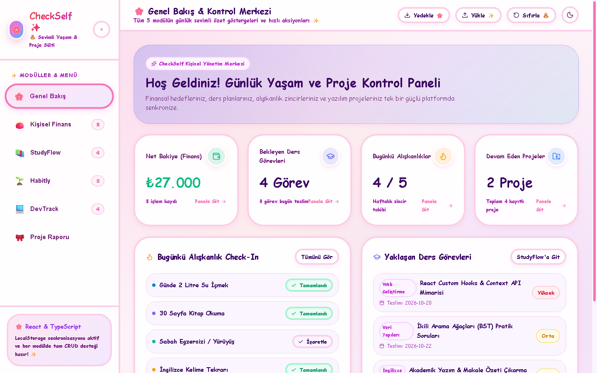
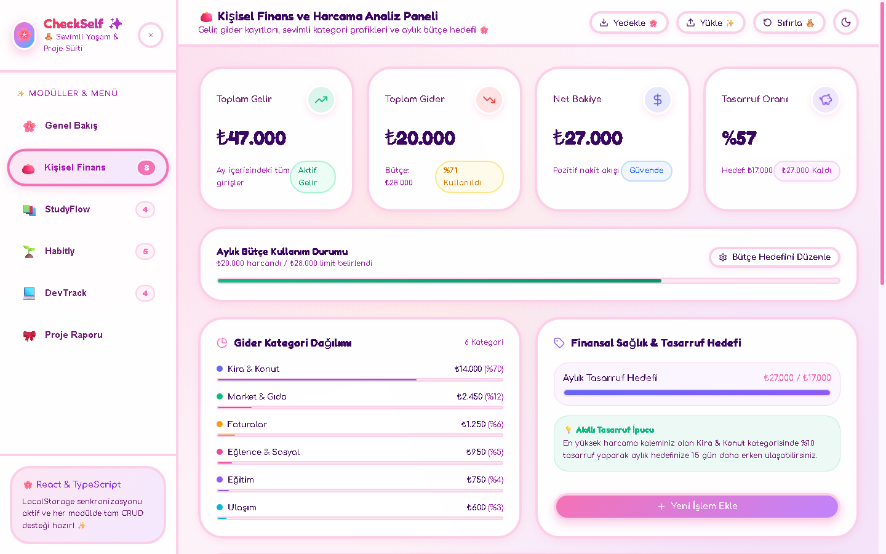
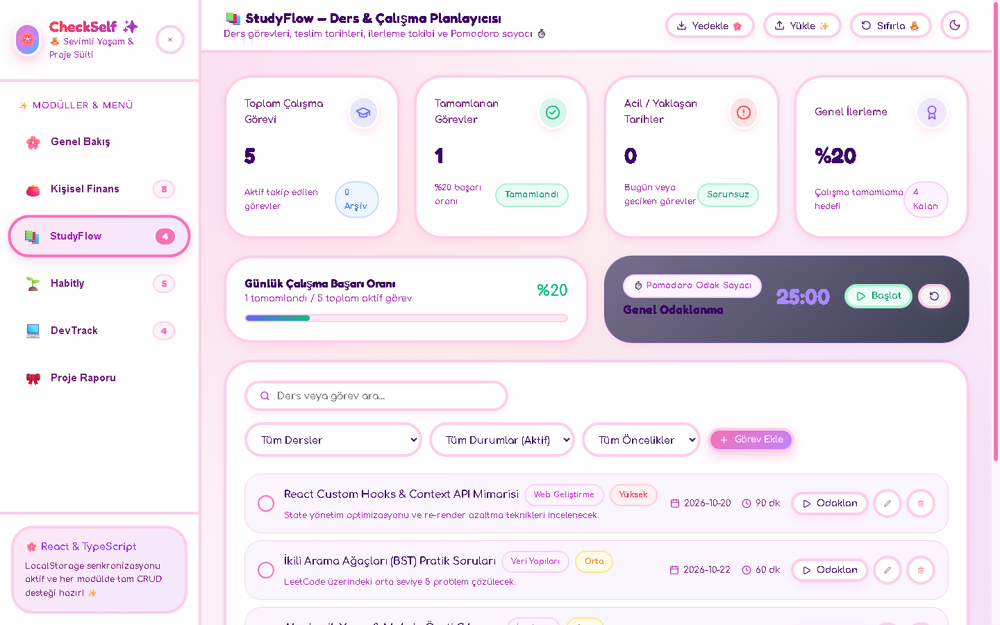
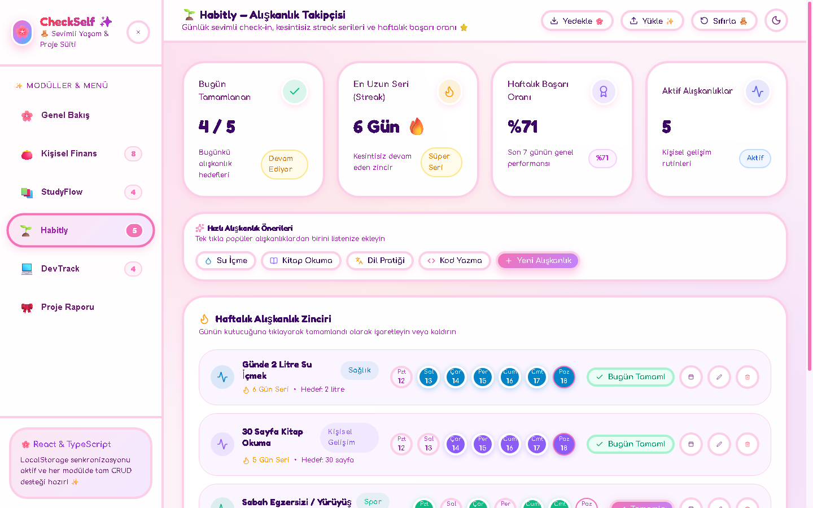
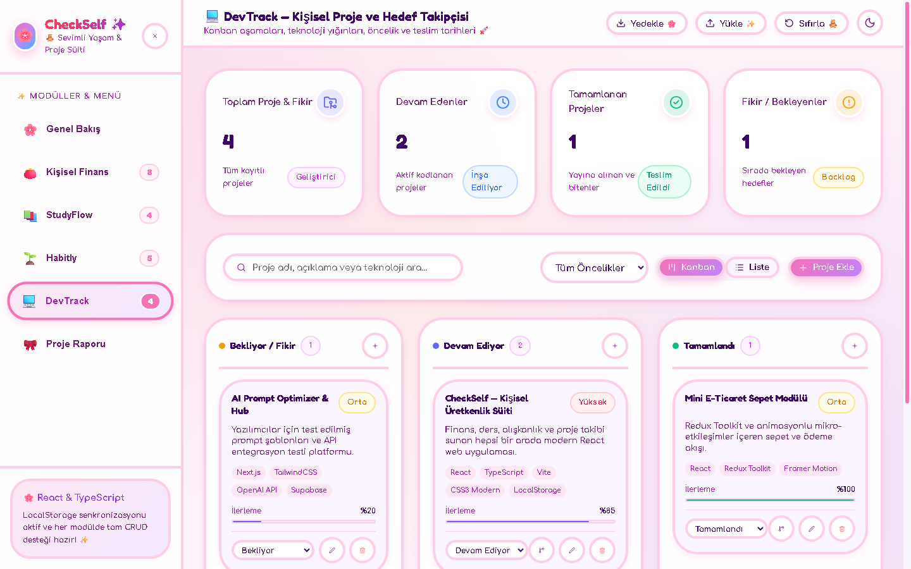
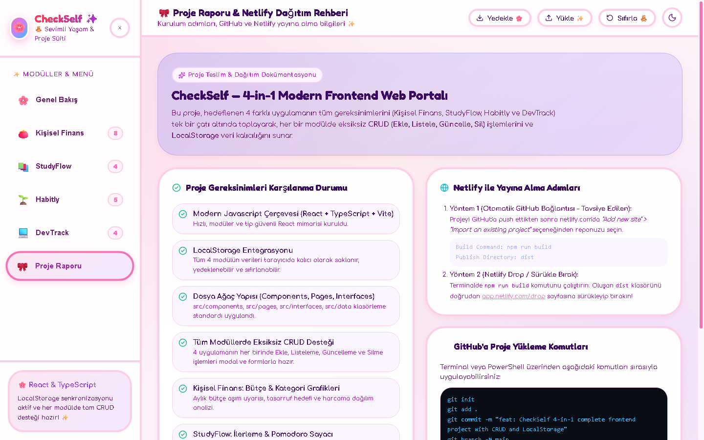

# 🚀 CheckSelf — 4-in-1 Kişisel Üretkenlik ve Yaşam Yönetim Süiti

> **Modern Frontend Web Geliştirme Projesi**  
> React 19, TypeScript, Vite ve Pure CSS ile geliştirilmiş; 4 temel üretkenlik ve takip uygulamasını (Kişisel Finans, StudyFlow, Habitly ve DevTrack) tek bir çatı altında birleştiren, tam CRUD işlemlerini ve LocalStorage veri kalıcılığını destekleyen hepsi bir arada web platformu.

---

## 📸 Proje Ekran Görüntüleri

Proje arayüzü; karanlık mod (dark mode) ve aydınlık mod (light mode) seçenekleri, cam morfolojisi (glassmorphism), akıcı geçiş animasyonları ve responsive mobil uyumlu tasarımıyla modern standartlara uygun olarak dizayn edilmiştir.

| Genel Bakış (Overview) | Kişisel Finans Paneli |
| :---: | :---: |
|  |  |

| StudyFlow Ders Planlayıcı | Habitly Alışkanlık Takipçisi |
| :---: | :---: |
|  |  |

| DevTrack Proje Yönetimi | Proje Raporu & Dokümantasyon |
| :---: | :---: |
|  |  |

---

## 🌟 Projeye Dahil Edilen 5 Uygulama ve Özellikleri

### 1. 💰 Kişisel Finans ve Harcama Analiz Paneli
- **Ekle / Güncelle / Sil:** Gelir ve giderleri başlık, tutar, kategori, tarih ve açıklama bilgisiyle yönetme.
- **Filtreleme & Arama:** Gelir/Gider tipi, kategori ve tarihe göre anında filtreleme ve sıralama.
- **Aylık Bütçe ve Tasarruf:** Harcama bütçesi limiti belirleme, aşım durumunda görsel uyarı ve tasarruf hedefi ilerleme çubuğu.
- **Kategori Dağılımı:** Harcamaların kategorilere göre yüzdesel ve renkli grafik dağılımı.

### 2. 📚 StudyFlow — Akıllı Ders ve Çalışma Planlayıcısı
- **Ders & Görev Yönetimi:** Görev başlığı, ders türü, son teslim tarihi, tahmini süre ve öncelik seviyesi belirleme.
- **İlerleme & Tamamlama:** Tek tıkla tamamlandı işaretleme ve günlük başarı yüzdesi hesaplama.
- **Yaklaşan Teslim Tarihleri:** Bugün teslim edilecek ve geciken görevler için renkli uyarı rozetleri.
- **⏱️ Pomodoro Sayacı:** Sayfa içerisinde entegre 25 dakikalık odaklanma zamanlayıcısı ve mola uyarısı.

### 3. 🔥 Habitly — Alışkanlık Takip Uygulaması
- **Alışkanlık Oluşturma:** Hedef miktar, birim, kategori ve renk paleti seçimiyle alışkanlık tanımlama.
- **Son 7 Gün Zincir Takibi:** Günlük etkileşimli kutucuklarla tamamlama check-in'i.
- **Seri (Streak) ve Başarı Oranı:** Kesintisiz gün serisi hesabı ve haftalık genel başarı oranı.
- **Geçmiş & Motivasyon:** Tüm tamamlanma geçmişi modalı ve gün tamamlandığında konfeti kutlaması.

### 4. 💻 DevTrack — Kişisel Proje ve Hedef Takipçisi
- **Kanban & Liste Görünümleri:** Bekliyor (Backlog), Devam Ediyor (In Progress) ve Tamamlandı (Completed) aşamaları.
- **Teknoloji Etiketleri:** Projeye özel dinamik teknoloji yığınları (React, Vite, Supabase vb.) ekleme.
- **Öncelik & İlerleme:** Son tarih ve yüzde üzerinden kaydırılabilir ilerleme barı.
- **Harici Bağlantılar:** GitHub reposu ve canlı demo URL alanları.

### 5. 🎀 Proje Raporu & Dağıtım Dokümantasyonu
- **Gereksinim Kontrol Listesi:** Tüm proje isterlerinin doğrulandığı özet tablo.
- **Yedekleme & Sıfırlama:** JSON tabanlı içe/dışa aktarma ve tek tıkla demo verileri sıfırlama.
- **Netlify & GitHub Kılavuzu:** Adım adım yayına alma ve sürüm kontrol komutları.

---

## 🛠️ Klasör ve Dosya Ağacı Yapısı

```
new-folder/
├── public/
│   ├── _redirects              # Netlify SPA yönlendirme kuralı
│   └── favicon.svg
├── screenshots/                # Uygulama ekran görüntüleri
├── src/
│   ├── components/             # Yeniden kullanılabilir UI bileşenleri
│   │   ├── ConfirmModal.tsx    # Güvenli silme onay modalı
│   │   ├── Modal.tsx           # Erişilebilir dinamik form modalı
│   │   ├── Navbar.tsx          # Üst navigasyon, tema & veri yedekleme
│   │   ├── Sidebar.tsx         # Modüller arası geçiş menüsü
│   │   └── StatCard.tsx        # Cam morfolojik metrik kartları
│   ├── data/
│   │   └── initialData.ts      # 5 modül için zengin Türkçe örnek veriler
│   ├── interfaces/
│   │   └── index.ts            # Tüm TypeScript tip tanımlamaları
│   ├── pages/
│   │   ├── AboutPage.tsx       # Proje teslim ve yayına alma kılavuzu
│   │   ├── DevTrackPage.tsx    # 4. Proje ve hedef takipçisi (Kanban)
│   │   ├── FinancePage.tsx     # 1. Finans ve bütçe analiz paneli
│   │   ├── HabitlyPage.tsx     # 3. Alışkanlık takipçisi ve streak
│   │   ├── OverviewPage.tsx    # Komuta merkezi & özet göstergeler
│   │   └── StudyFlowPage.tsx   # 2. Ders çalışma & Pomodoro
│   ├── utils/
│   │   └── storage.ts          # LocalStorage, JSON import/export & ID üretici
│   ├── App.tsx                 # Ana uygulama ve durum yönetimi
│   ├── index.css               # Modern CSS tasarım sistemi, temalar & animasyonlar
│   └── main.tsx                # React başlangıç noktası
├── netlify.toml                # Netlify otomatik dağıtım konfigürasyonu
├── package.json
├── tsconfig.json
└── vite.config.ts
```

---

## ⚙️ Kurulum ve Yerel Çalıştırma

Projeyi bilgisayarınızda çalıştırmak için aşağıdaki adımları izleyin:

```bash
# 1. Bağımlılıkları yükleyin
npm install

# 2. Geliştirme sunucusunu başlatın
npm run dev

# 3. Tarayıcınızda açın (Varsayılan: http://localhost:5173)
```

Üretim derlemesini (Production Build) test etmek için:
```bash
npm run build
npm run preview
```

---

## 🌐 Netlify Üzerinde Yayına Alma

### Yöntem A — GitHub ile Otomatik Dağıtım (Önerilen):
1. Projenizi GitHub'a push edin.
2. [netlify.com](https://www.netlify.com/) hesabınıza giriş yapın.
3. **"Add new site"** > **"Import an existing project"** adımlarını izleyin.
4. GitHub deponuzu seçin:
   - **Build Command:** `npm run build`
   - **Publish directory:** `dist`
5. **Deploy Site** butonuna tıklayın.

### Yöntem B — Netlify Drop (Sürükle-Bırak):
1. Terminalde `npm run build` komutunu çalıştırın.
2. Proje kök dizininde oluşan **`dist`** klasörünü [app.netlify.com/drop](https://app.netlify.com/drop) sayfasına sürükleyip bırakın. Siteniz 10 saniye içinde canlıya alınır!

---

## 🐙 GitHub'a Yükleme Adımları

Projeyi kendi GitHub hesabınıza yüklemek için:

```bash
# Git başlatın
git init

# Dosyaları sahneye ekleyin
git add .

# İlk commit'i oluşturun
git commit -m "feat: CheckSelf 4-in-1 complete application with CRUD & LocalStorage"

# Ana dalı belirleyin
git branch -M main

# Kendi GitHub reponuzu bağlayın
git remote add origin https://github.com/KULLANICI_ADINIZ/REPO_ADINIZ.git

# GitHub'a gönderin
git push -u origin main
```

---

## 📋 Değerlendirme Kriterleri Uyumluluk Tablosu

| Kriter | Uygulama Durumu | Detay |
| :--- | :---: | :--- |
| **Modern JS Çerçevesi** | ✅ | React 19 + TypeScript + Vite |
| **LocalStorage Desteği** | ✅ | Tüm 5 modülde kalıcı veri saklama, JSON yedekleme ve sıfırlama |
| **Klasör Ağacı Yapısı** | ✅ | `Components`, `Pages`, `Interfaces`, `Data`, `Utils` |
| **Ekle (Create)** | ✅ | 5 modülün tamamında modal formlar |
| **Listeleme (Read)** | ✅ | Filtreli, sıralı ve aramalı listeler, kartlar ve Kanban |
| **Güncelleme (Update)** | ✅ | Her kayıtta form üzerinden tam düzenleme |
| **Silme (Delete)** | ✅ | Güvenli onay modalı (ConfirmModal) ile silme |
| **Ekran Görüntüleri** | ✅ | `screenshots/` klasöründe yer alır |
| **Netlify Uyumlu** | ✅ | `_redirects` ve `netlify.toml` hazır |
